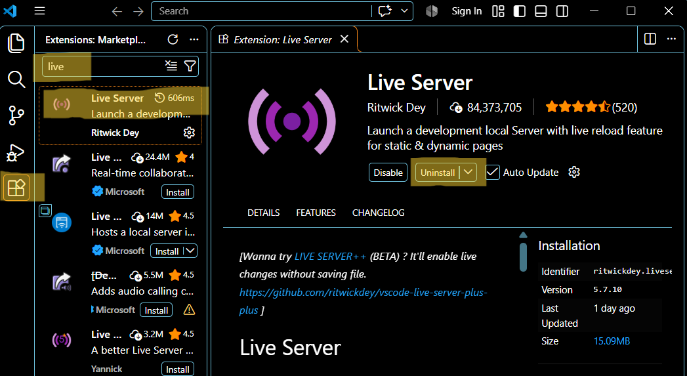
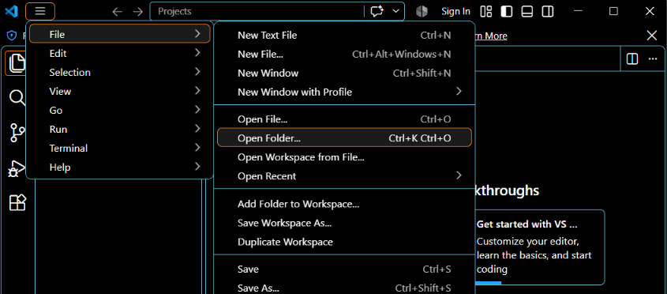
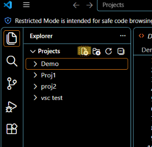
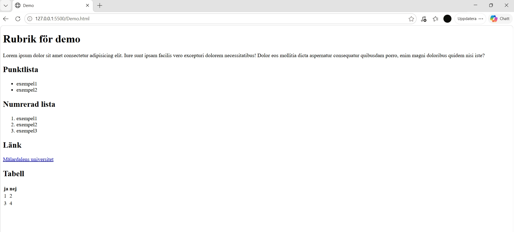

# Utveckla en webbsida med VS Code
En kortare beskrivning av hur du som nybörjare kommer igång med att skriva html-kod i VS Code (Visual Studio Code). Detta är förutsatt att du har laddat ner programmet på din dator. 


## Steg 1 - installera extensions
När du har kommit in i VS Code installera extensions Live server och Lorem Ipsum. Bilden nedan visar hur du hittar dem. Där det i bilden står uninstall ska det stå install för dig. 



## Steg 2 - öppna mapp och skapa fil
För att öppna en mapp som ligger i utforskaren på datorn följ då stegen på bilden nedan. Då kommer filen du skapar lagras där. 



När du kommit in i en mapp på ser det ut som på bilden nedan. Välj då den markerade ikonen för att skapa en ny fil. Döp den till tex Demo.html. Den ska sluta på .html men namnet väljer du själv.



## Steg 3 - börja skriva html
Börja med att skriva in `!` och tryck enter. Då fyller Emmet i allt du behöver för att börja koda.

Därefter ändrar du vad webbsidans namn ska vara när den visas som en flik i webbläsaren. Det gör du i `<head>` och `<titel></titel>`. Från början står det Document som du ser nedan.
```html 
<head> 
<meta charset="UTF-8"> 
<meta name="viewport" content="width=device-width, initial-scale=1.0"> 
<title>Document</title> 
</head>
```

`<head>` är platsen för metadata. 

## Steg 4 - rubriker
Nu ska du skriva i `<body>` och i den ordning som du vill att informationen visas i på webbsidan. 

För att skapa en huvudrubrik skriver du `<h1>DinRubrik</h1>`. Välj `<h2>`, `<h3>` och `<h4>` etc för att göra mindre och mindre underrubriker.

##### Obs! Alla kommande steg ska göras i `<body>`.


## Steg 5 - brödtext med lorem ipsum
Använd `<p>`för att skriva brödtext. Börjar du sedan skriva lorem och väljer Emmet Abbreviation "Lorem" får du in Lorem Ipsum som exempeltext. 

## Steg 6 - att göra en punktlista
Skriv in `<ul>` och välj Emmet Abbreviation ul för att skapa en punktlista. Skriv `li` och välj Emmet Abbreviation li för att skapa en punkt i listan. Byt rad och upprepa `li` för en ny punkt. 

Det bör se ut så här då. 
```
<ul>
      <li>exempel1</li>
      <li>exempel2</li>
</ul>
```

## Steg 7 - att göra en numrerad lista
Upprepa steg 6 men byt ut `ul` till `ol`. Dvs byt från unordered list till ordered list.

## Steg 8 - infoga en länk
Skriv in `a` på en tom rad och välj Emmet Abbreviation för a. Då kommer det se ut så här: `<a href=""></a>`. Inom citattecken lägger du in önskad webbadress. Det du vill att webbplatsen ska kallas på din sida skriver du precis innan `</a>`.

Så här ser det ut om man lägger in MDU. `<a href="https://mdu.se">Mälardalens universitet</a>`

## Steg 9 - skapa en tabell
Skriv in table och välj Emmet Abbreviation för table. Lägg sedan till `<thead>` och sen `<th>`för att få rubriker över kolumnerna. `<tr>` står för en rad och `<td>` står för en kolumn på raden. Alltså ska `<td>` finnas inom varje `<tr>` likt exemplet nedan.

```
 <table>
            <thead>
                <th>ja</th>
                <th>nej</th>
            </thead>
            <tr>
                <td>1</td>
                <td>2</td>
            </tr>
            <tr>
                <td>3</td>
                <td>4</td>
            </tr>
    </table>
```

## Resultatet
Så här ser det ut när du är klar och visar projektet med Live server.

 
